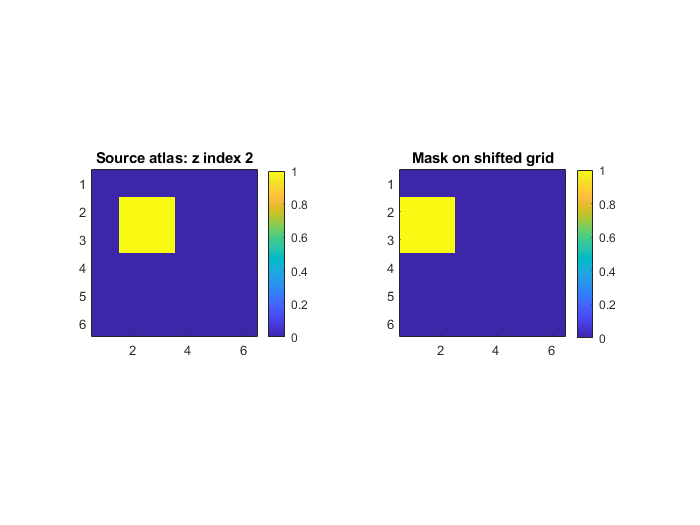

# Synthetic example: A tiny atlas with an exactly known mask

Download the [repository ZIP with the example and readiness fixes](https://github.com/MPG-Git/roi-mask-builder/archive/refs/heads/codex/readiness-20261107.zip),
extract it to a writable folder, and follow the setup below. These changes are
on the review branch; downloading the older default branch may omit them.
The input files and reference outputs are already included; generation is optional.

## Run and inspect

This is a standalone MATLAB/SPM workflow, not an EEGLAB plugin. Install the full
SPM12 distribution. From the extracted repository folder in MATLAB:

```matlab
addpath('C:/path/to/spm12'); % change this to your full SPM12 installation
addpath('examples/synthetic');
run_roi_demo;
```

Reference run: MATLAB R2023b and SPM12. The supplied 6 x 6 x 6 atlas has two
eight-voxel cubes: label 1 at MATLAB voxel indices `(2:3,2:3,2:3)` and label 2 at
`(4:5,4:5,4:5)`. `labels.txt` maps line 1 to RegionOne and line 2 to RegionTwo.
Both `.nii` and `.nii.gz` atlas inputs are supplied. Voxel sizes are 1 mm.
The reference image has its x affine translation shifted by +1 mm.

The runner selects RegionOne using the compressed atlas and shifted reference.
`region_one_mask.nii` must contain **exactly 8 binary voxels**, now at
`(1:2,2:3,2:3)`, and must have the reference affine. It checks all voxels against
this analytic answer and the included reference NIfTI. The JSON sidecar stores
provenance for your run; paths/timestamps naturally differ between computers.

For the GUI, add `src`, run `make_roi_mask_from_atlas`, select these three input
files and RegionOne, and save to a new `.nii` file. Compare that image with
`expected/region_one_mask.nii`. Resampling changes the voxel grid; it does not
perform anatomical registration.



Recreate the inputs with `generate_roi_data('new_data')`.

## What counts as success

A successful run prints `PASS` and writes `PASS.txt` and `comparison.csv` into
the new output folder. Errors and mismatches stop the runner without a PASS file.
Open the CSV comparison and compare your plots with `expected/`.
The included reference outputs came from actual runs on November 7, 2026.

The default output is this example's `output/` directory. Existing output folders
are refused so a previous result cannot be mistaken for a fresh run. MATLAB
runners accept a new output folder as their first argument (for example,
`run_roi_demo('demo_run_2')`).

If a comparison fails, inspect the reported metric and confirm that you used
these bundled files, this repository version, and the listed dependencies.
Do not replace the reference with the failing result. `SHA256SUMS.json` records
input/reference file hashes for download-integrity checks. All input data are
generated; no participant recordings or personal data are included. The supplied
generators refuse to overwrite an existing destination.

These examples check the illustrated installation and workflow, not every menu
item or scientific validity for a particular study. Reference plots may render
differently with another operating system or graphics version.
